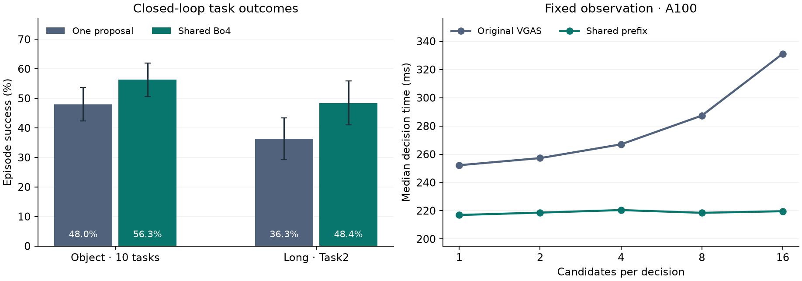
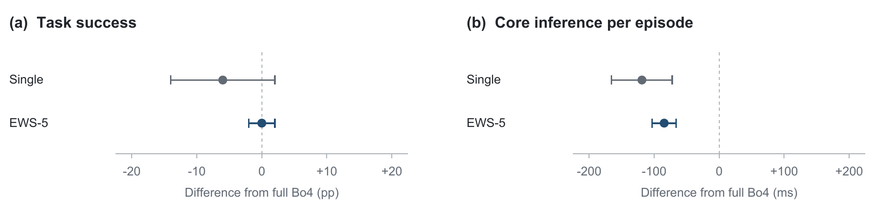

# Allocating test-time compute in SmolVLA

We share SmolVLA's observation encoding across proposal generation and VGAS scoring, and evaluate when four-way selection is worth its inference cost. The actor, critic and scoring rule are from VGAS.

[Paper PDF](paper/main.pdf) · [Code](method/shared_prefix_selection.py) · [Data and settings](docs/REPRODUCIBILITY.md) · [License](LICENSE)



Left: marginal 95% bootstrap intervals resample physical layouts, keeping noise repeats together. The table below reports intervals for paired differences. Right: median latency over 60 repetitions per condition on a fixed Object observation, with the critic active even at one candidate. [Figure code](scripts/plot_overview.py) · [Latency measurements](results/fixed-observation-latency.csv)

- **Task outcome.** Four-way selection improved Object success by 8.33 percentage points and Long Task2 by 12.11 points against one SmolVLA proposal.
- **System cost.** At four candidates, sharing reduced the mean A100 decision time in Object rollouts from 271.64 to 216.78 ms. Single-proposal SmolVLA took 210.57 ms.
- **Scaling.** Increasing the candidate batch from one to sixteen raised fixed-observation median latency from 252.21 to 331.13 ms in original VGAS and from 216.97 to 219.66 ms with sharing.

## Four-way selection at early queries

We use four proposals at the first few control queries and one thereafter.
Each query commits up to 20 environment steps. On the 300-layout Object
sweep, five was the smallest tested cutoff within 3 percentage points of
full selection by point estimate. Goal and Spatial used the preregistered one-third rule. The Plus lighting cohort reused Object's cutoff.

| Paired cohort | Schedule | Single | Full Bo4 | Early window | Four-way calls, full to early |
|---|---|---:|---:|---:|---:|
| Object calibration (300) | First five | 144 | 169 | 167 | 3,099 → 1,500 |
| Object new layouts (200) | First five | 98 | 110 | 110 | 2,061 → 1,000 |
| Long Task2 (256) | First eight | 93 | 124 | 127 | 4,949 → 2,048 |
| LIBERO-Goal (300) | First five | 145 | 165 | 159 | 2,996 → 1,484 |
| LIBERO-Spatial (300) | First five | 131 | 142 | 141 | 3,046 → 1,491 |
| Plus lighting (300) | First five | 100 | 123 | 123 | 3,376 → 1,500 |

The early-window differences from full Bo4 were −0.67 pp [−2.67, 1.33],
0.00 pp [−2.00, 2.00], +1.17 pp [−5.08, 7.42], −2.00 pp [−6.00, 2.00],
−0.33 pp [−5.00, 4.33], and 0.00 pp [−2.00, 2.00], respectively. Each point
estimate is within the 3 pp tolerance. On Spatial, Late finished 131/300,
with a paired difference from single of 0.00 pp [−4.00, 4.00].
The fresh Object difference from one proposal was +6.00 pp [−2.00, 14.00].
Across 500 paired Object layouts, first-five outperformed Late (+7.60 pp [2.60, 12.60]), with 2,500 versus 2,893 realized four-way calls.
Late uses one proposal at queries 1–5 and four thereafter. The counts measure workload and depend on episode termination.
The [Object branch analysis](results/scheduled_selection/critic-oracle.json) estimates how often the released critic, uniform selection and a four-candidate oracle find a successful branch under fixed single-proposal continuation.

[Data and protocol](results/scheduled_selection/README.md) · [Recompute the
comparisons](scripts/summarize_scheduled_selection.py) · [Paper PDF](paper/main.pdf)

## Closed-loop results

| Question | Paired result | Success-rate difference |
|---|---|---:|
| Four proposals vs one · Object, ten tasks | 144 → 169 successes / 300 | +8.33 pp [1.67, 15.00] |
| Four proposals vs one · Long, Task2 | 93 → 124 / 256 | +12.11 pp [5.86, 18.75] |
| Four proposals vs one · Object with fixed Plus lighting | 100 → 123 / 300 | +7.67 pp, adjusted interval [−1.67, 17.00] |
| Shared vs original implementation · Object, four proposals in both | 170 → 169 / 300 | −0.33 pp [−5.00, 4.33] |

On Object the shared implementation saved **20.2%** of mean A100 decision time at four candidates. Timing includes encoding, generation and scoring. Action postprocessing and simulation are outside that timer. The success interval still allows several percentage points of difference. Long Task2 was selected in development and uses 128 historical layouts with two noise repeats each. All evaluations use LIBERO simulation. Target-chip latency and power remain unmeasured.

### Fixed-observation scaling

| Candidates | Original median (ms) | Shared median (ms) | Original peak allocated (MiB) | Shared peak allocated (MiB) |
|---:|---:|---:|---:|---:|
| 1 | 252.21 | 216.97 | 1624.5 | 1623.9 |
| 2 | 257.25 | 218.66 | 1656.7 | 1628.4 |
| 4 | 266.98 | 220.46 | 1714.9 | 1649.2 |
| 8 | 287.34 | 218.52 | 1829.4 | 1691.1 |
| 16 | 331.13 | 219.66 | 2063.5 | 1773.8 |

The ten action-expert steps took 188.68 ms at one candidate and 191.86 ms at sixteen in the stage profile. [Stage breakdown and roofline](docs/PROFILE.md).

### What changes with CUDA Graph replay?

On a fixed LIBERO-Object observation, capturing the ten action-expert steps reduced the four-proposal decision median from **225.74 to 80.54 ms**. The snapshot benchmark includes input refresh and excludes capture. [Protocol and raw samples](docs/PROFILE.md)

On 200 paired Object layouts, all three schedules used the same warm Graph path.

| Schedule | Successes | Four-way calls | Core ms/episode | Decision p50/p90 (ms) |
|---|---:|---:|---:|---:|
| Single proposal | 98/200 | 0 | 825.2 | 72.5 / 98.9 |
| Full Bo4 | 110/200 | 2,061 | 944.0 | 86.3 / 113.6 |
| EWS-5 | 110/200 | 1,000 | 859.4 | 82.4 / 102.2 |

EWS-5 reduced mean core inference by **9.0%** versus full Bo4 (−84.55 ms, paired 95% interval [−103.24, −66.24]). The paired success difference was 0.0 pp [−2.0, 2.0]. [Data, protocol and recomputation](results/graph-closed-loop/README.md)



Points compare each schedule with full Bo4. Whiskers show task-stratified paired 95% intervals.

## Architecture


**VGAS supplies** the frozen actor, the suite-specific critic and the selection rule. **Our implementation** shares the observation encoding across generation and scoring, preserves separate noise for each proposal, and dispatches the winning chunk. Both critic heads evaluate the first 32 proposed steps on Object or all 50 on Long. The smaller of the two scores ranks each proposal. An episode that succeeds during execution stops immediately. [VGAS source](https://github.com/Jyugo-15/VGAS) · [Pinned weights and evaluation settings](docs/REPRODUCIBILITY.md)

## Installation and evaluation

Follow the [installation and full evaluation instructions](docs/INSTALL.md) for the frozen SmolVLA and suite-specific VGAS critic.

```bash
python scripts/eval_libero.py --suite object --candidates 4 --impl shared --seed 42 --episodes 2
```

## Run a real example

From the repository root, Python 3 is sufficient to inspect a recorded decision and verify the benchmark arithmetic.

```bash
python examples/inspect_decision.py --task 0 --query first
python scripts/verify_results.py
```

In that recorded query, the four scores are **−59.346, −61.862, −56.383 and −57.653**. Candidate **2** (zero-based) wins. Scores express relative preference among chunks at this observation; they have no percentage interpretation. The corresponding call inside a loaded evaluation environment is:

```python
from method.shared_prefix_selection import select, selected_action

pool, scores, winner, _ = select(policy, trainer, batch, noise)
normalized_chunk = selected_action(pool, winner)  # keep batch dimension
# Apply the actor's action postprocessor before sending up to 20 steps to the robot.
```

The [benchmark driver](scripts/benchmark_value_readout.py) shows how the policy, critic, observation processor and noise tensors are initialized. The standalone evaluator completed two full Object episodes in a freshly installed server environment using cached packages and pinned assets. The historical headline cohorts and their exact controls are documented in the [reproduction notes](docs/REPRODUCIBILITY.md).

## Critic weight storage

On Object, per-channel INT8 storage reduced the frozen critic's persistent tensor payload from **175.03 MB to 44.02 MB** including scales. It selected the original winner on **495/500** archived queries. On the same 300 physical layouts, the INT8-storage arm succeeded **170** times, full-precision shared Bo4 **169**, and single-proposal SmolVLA **144**. INT8 minus full precision was +0.33 pp (paired bootstrap 95% interval [0.00, 1.00], one rescue and zero harms). Weights are unpacked for computation. Native INT8 latency and target-chip execution remain open. [Precision analysis, case outcomes and code](docs/PRECISION.md).

## Compute per episode

| Suite and arm | Candidates per query | Additional critic parameters | Mean decision time | Mean queries per episode |
|---|---:|---:|---:|---:|
| Object · SmolVLA | 1 | 0 | 210.57 ms | 10.84 |
| Object · original Bo4 | 4 | 43,756,674 | 271.64 ms | 10.32 |
| Object · shared Bo4 | 4 | 43,756,674 | 216.78 ms | 10.33 |
| Long Task2 · SmolVLA | 1 | 0 | 245.30 ms | 21.05 |
| Long Task2 · shared Bo4 | 4 | 43,756,674 | 250.01 ms | 19.33 |

The same four proposals form one batch. Prefix/KV reuse has precedents in language models and robotics. Our contributions are the shared-prefix inference implementation, the A100 measurements, and the paired evaluation of when to spend the proposal budget. We also evaluate INT8 critic weight storage in closed-loop simulation. [Related systems and attribution](docs/HARDWARE_ANALYSIS.md).

## How we arrived here

Matched replanning and zero-gradient controls narrowed what we could attribute to visual alerts and gradient guidance. Comparing completed candidates then gave us a way to test task value separately from execution cost. A later readout experiment kept the selected action on 20/20 replayed observations, but the A100 timing supported keeping the original critic readout. [Exploration, controls and candidate-budget figure](docs/RESEARCH_PATH.md) · [Corrector and QGF workshop draft](workshop/README.md) · [Raw results](results/) · [Attribution](docs/ATTRIBUTION.md)

## Paper materials

[Algorithm and evaluation text](paper/algorithm.tex) · [Generated LaTeX tables](paper/tables/) · [Table generator](scripts/make_paper_tables.py).

## Simulation demos

[View paired Object rollouts and original MP4 recordings](docs/DEMOS.md).

## Citation and acknowledgments

The software citation below identifies this artifact while the manuscript is in preparation. The repository preserves the upstream weights and evaluation provenance in its [third-party notices](THIRD_PARTY_NOTICES.md).

```bibtex
@software{sharedprefix_smolvla_2026,
  author  = {{Shared-prefix SmolVLA contributors}},
  title   = {Shared-prefix inference for VGAS on SmolVLA},
  year    = {2026},
  version = {0.1.0},
  url     = {https://github.com/Tony1984creator/smolvla-shared-prefix-vgas}
}
```

This artifact uses [Xu et al., VGAS](https://ijcai.org/proceedings/2026/569), [LeRobot](https://github.com/huggingface/lerobot) and [Liu et al., LIBERO](https://arxiv.org/abs/2306.03310). The [workshop technical-report draft](workshop/README.md) documents the earlier [VLA-Corrector](https://github.com/ZJU-OmniAI/vla-corrector) and [Q-Guided Flow](https://github.com/zhouzypaul/qgf) reproductions. Original project code is available under the [MIT license](LICENSE).
