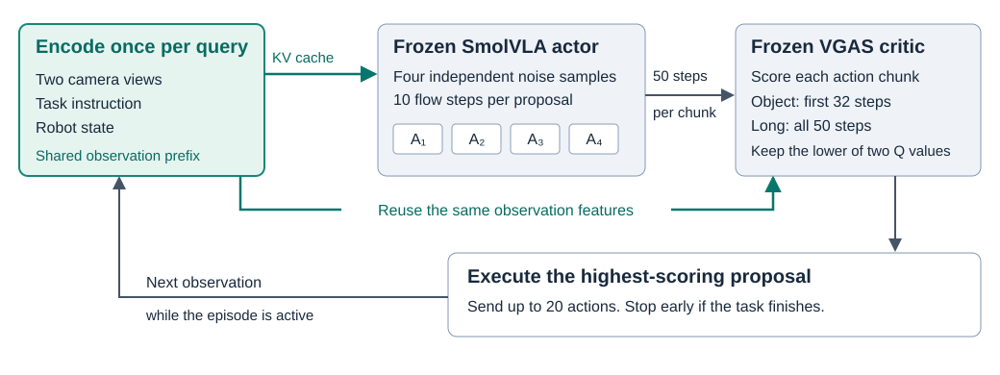

# Shared-prefix inference for VGAS on SmolVLA

We implement shared observation encoding for the released VGAS four-candidate selector on SmolVLA. Each control query encodes the scene once, generates four action chunks, and executes the highest-scoring proposal. On LIBERO-Object, prefix sharing reduces mean A100 decision time from **271.64 to 216.78 ms** at the same candidate count.

[Method and code](method/shared_prefix_selection.py) · [Reproduce the numbers](docs/REPRODUCIBILITY.md) · [Research path](docs/RESEARCH_PATH.md) · [Hardware analysis](docs/HARDWARE_ANALYSIS.md) · [中文汇报图](docs/briefing.png)

## Architecture



**VGAS supplies** the frozen actor, the suite-specific critic and the selection rule. **Our implementation** shares the observation encoding across generation and scoring, preserves separate noise for each proposal, and dispatches the winning chunk. Both critic heads evaluate the first 32 proposed steps on Object or all 50 on Long. The smaller of the two scores ranks each proposal. An episode that succeeds during execution stops immediately. [VGAS source](https://github.com/Jyugo-15/VGAS) · [Pinned weights and evaluation settings](docs/REPRODUCIBILITY.md)

## Run a real example

From the repository root, Python 3 is sufficient to inspect a recorded decision and verify the benchmark arithmetic.

```bash
python examples/inspect_decision.py --task 0 --query first
python scripts/verify_results.py
```

In that recorded query, the four scores are **−59.346, −61.862, −56.383 and −57.653**. Candidate **2** (zero-based) wins. Scores express relative preference among chunks at this observation; they have no percentage interpretation. The corresponding call inside a loaded evaluation environment is:

```python
from method.shared_prefix_selection import select, selected_action

pool, scores, winner, _ = select(policy, trainer, batch, noise)
normalized_chunk = selected_action(pool, winner)  # keep batch dimension
# Apply the actor's action postprocessor before sending up to 20 steps to the robot.
```

The [benchmark driver](scripts/benchmark_value_readout.py) shows how the policy, critic, observation processor and noise tensors are initialized. Full simulation uses the archived evaluator and assets described in the [reproduction notes](docs/REPRODUCIBILITY.md); a fresh-machine end-to-end run remains unverified.

## Closed-loop results

| Question | Paired result | Success-rate difference |
|---|---|---:|
| Four proposals vs one · Object, ten tasks | 144 → 169 successes / 300 | +8.33 pp [1.67, 15.00] |
| Four proposals vs one · Long, Task2 | 93 → 124 / 256 | +12.11 pp [5.86, 18.75] |
| Four proposals vs one · Object with fixed Plus lighting | 100 → 123 / 300 | +7.67 pp, adjusted interval [−1.67, 17.00] |
| Shared vs original implementation · Object, four proposals in both | 170 → 169 / 300 | −0.33 pp [−5.00, 4.33] |

On Object the shared implementation saved **20.2%** of mean A100 decision time at four candidates. Timing includes encoding, generation and scoring. Action postprocessing and simulation are outside that timer. The success interval still allows several percentage points of difference. Long Task2 was selected in development and uses 128 historical layouts with two noise repeats each. All evaluations use LIBERO simulation. Target-chip latency and power remain unmeasured.

## How we arrived here

Matched replanning and zero-gradient controls narrowed what we could attribute to visual alerts and gradient guidance. Comparing completed candidates then gave us a way to test task value separately from execution cost. A later readout experiment kept the selected action on 20/20 replayed observations, but the A100 timing supported keeping the original critic readout. [Exploration, controls and candidate-budget figure](docs/RESEARCH_PATH.md) · [Corrector and QGF workshop draft](workshop/README.md) · [Raw results](results/) · [Attribution](docs/ATTRIBUTION.md)

## Simulation demos

[View paired Object rollouts and original MP4 recordings](docs/DEMOS.md).
