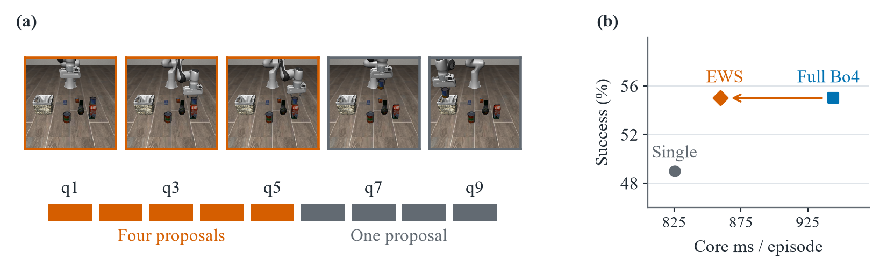
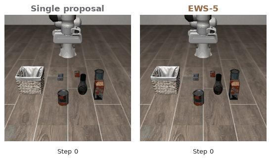

# Spend Selection Early

Early-window selection (EWS) uses four SmolVLA proposals near the start of an episode and one thereafter, concentrating VGAS scoring where it yielded the most benefit.



**(a)** One recorded LIBERO-Object episode. Frames mark queries 1, 3, 5, 7, and 9, and the strip shows all reached queries. **(b)** Success and mean core inference time on the same 200 layouts under warm CUDA Graph replay.

- **When to select.** On paired Object layouts, the early window beat the tested Late schedule by **7.60 percentage points**, with a 95% paired interval of [2.60, 12.60].
- **How much it saves.** Across the tested cohorts, EWS reduced realized four-way calls by about half while remaining within the specified 3 pp point-estimate tolerance of full selection.
- **Measured A100 cost.** Under warm CUDA Graph replay, EWS and full Bo4 each succeeded in **110/200** episodes. EWS reduced core inference time per episode by **9.0%**.

[Paper PDF](paper/main.pdf) · [中文一页总结](docs/SUMMARY_CN.md) · [Evidence audit](paper/CLAIMS_AUDIT.md) · [Extended experiment guide](docs/RESULTS_GUIDE.md)



The two rollouts start from the same Object layout and policy seed. The GIF shows snapshots at control-query boundaries and holds the terminal frame of each arm. [Recording details](docs/DEMOS.md)

## Closed-loop results

<!-- cohort-table:start -->
| Cohort | Single | Full Bo4 | EWS | Late | Four-way calls saved |
|---|---:|---:|---:|---:|---:|
| Object calibration | 144/300 | 169/300 | 167/300 | 141/300 | 51.6% |
| Object new layouts | 98/200 | 110/200 | 110/200 | 98/200 | 51.5% |
| Long Task2 | 93/256 | 124/256 | 127/256 | — | 58.6% |
| Goal | 145/300 | 165/300 | 159/300 | 138/300 | 50.5% |
| Spatial | 131/300 | 142/300 | 141/300 | 131/300 | 51.1% |
| Plus lighting | 100/300 | 123/300 | 123/300 | — | 55.6% |
<!-- cohort-table:end -->

Each cell reports successful episodes over the cohort. The manuscript gives paired EWS-minus-full intervals. Goal and Spatial were evaluated under preregistered point-estimate criteria. Long is the development-selected Task2. [Paired data and protocols](results/scheduled_selection/README.md)

On the 300 Object calibration layouts, EWS-5 won 167 episodes. Full Bo2, Bo2 for ten queries, and Bo8 for three won 142, 141, and 148. Each schedule used a different realized extra-proposal budget. [Paired width and timing results](results/width-time/README.md)

## Reproduce

```sh
python scripts/verify_results.py
python -m pip install numpy matplotlib pillow
python scripts/summarize_width_time.py
python paper/make_submission.py
tectonic --outdir paper paper/main.tex
```

[Install and run the policy](docs/INSTALL.md) · [Pinned checkpoints and settings](docs/REPRODUCIBILITY.md) · [Paper build](paper/README.md) · [License and upstream notices](THIRD_PARTY_NOTICES.md)

## Citation

~~~bibtex
@software{sharedprefix_smolvla_2026,
  author  = {{Shared-prefix SmolVLA contributors}},
  title   = {Shared-prefix inference for VGAS on SmolVLA},
  year    = {2026},
  version = {0.2.0},
  url     = {https://github.com/Tony1984creator/smolvla-shared-prefix-vgas}
}
~~~

The [workshop draft](workshop/README.md) records the earlier VLA-Corrector and Q-Guided Flow reproductions.
