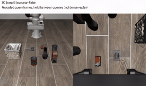
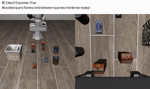

# Paired simulation rollouts
Two archived LIBERO-Object rollouts show why we count both recoveries and harms. Within each row the actor starts from the same physical layout with the same policy-noise index. The clips show recorded camera observations at policy queries; their durations differ because episodes can finish early.

| Paired Object case | SmolVLA · execute one proposal | VGAS · score four and execute the winner |
|---|---|---|
| **Recovery** · task 0, layout 22, noise 1 |  · [MP4](media/object_rescues_0_BC.mp4) |  · [MP4](media/object_rescues_0_Bo4.mp4) |
| **Harm** · task 1, layout 22, noise 0 |  · [MP4](media/object_damages_0_BC.mp4) |  · [MP4](media/object_damages_0_Bo4.mp4) |

These clips come from the earlier **native VGAS** comparison. They illustrate the selection mechanism. The [main benchmark](../README.md#closed-loop-results) measures the shared-prefix implementation.
