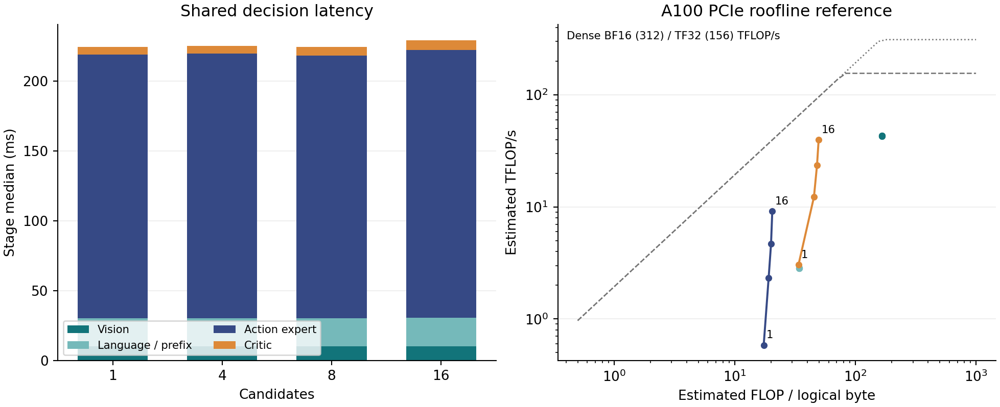

# Where the computation goes

The question for a small accelerator is which work must scale with four proposed actions. At one control query the camera images, instruction and robot state are identical across all proposals. Each proposal still needs independent noise, action generation and a score. Our deployed-in-simulation path encodes the observation once, reuses its actor attention cache and supplies its features to the released critic. The next control query starts from a new observation.

The four-candidate selection rule and pretrained networks come from VGAS. We implemented shared observation encoding, characterized decision latency on A100, and evaluated INT8 critic weight storage. Object and Long use the same LIBERO simulator; Long Task2 was selected during development. Target-chip latency and energy remain unmeasured. [Precision measurements](PRECISION.md).

## Candidate scaling on A100



At one candidate, vision and prefix encoding represent 79% of the counted FLOPs, while the ten-step action expert accounts for 84% of stage latency. At sixteen candidates, expert latency rose from 188.68 to 191.86 ms. These stage timings document batching behavior; bandwidth saturation requires hardware counters. [Measurements, byte accounting and replay input](PROFILE.md).

At four candidates, a warm CUDA Graph replay of the ten expert steps saved 75.0% of expert time versus matched eager execution. After replay the expert takes 37.37 ms at one candidate and 83.29 ms at sixteen. This isolates a substantial graph-removable execution cost in the eager implementation; it does not separately identify Python dispatch, driver launch overhead or device idle time. [A3 protocol and results](PROFILE.md).

## What prior work establishes

| Work | Decision or optimization | Relation to this artifact |
|---|---|---|
| [VGAS, pinned source](https://github.com/Jyugo-15/VGAS/tree/ef656cbed9b740e035e5bd2981578531e4076e85) | A learned task critic selects among policy proposals. | Supplies our actor, critic and candidate-selection rule. |
| [Q-Guided Flow](https://github.com/zhouzypaul/qgf) | A value gradient changes a developing action. | Separate reproduction and historical comparison in the workshop. |
| [VLA-Cache](https://proceedings.nips.cc/paper_files/paper/2025/file/f062da1973ac9ac61fc6d44dd7fa309f-Paper-Conference.pdf) | Reuses visual-token computation across frames. | We share a single observation across candidates within one decision. |
| [Zora](https://arxiv.org/abs/2611.11098) | Shares KV in speculative verification of autoregressive actions. | Candidate KV sharing already has precedent. Our benchmark concerns a flow actor coupled to a learned critic. |
| [PACT-VLA](https://arxiv.org/abs/2610.28019) | Scores candidate chunks with a newer observation using a frozen policy and pipelined inference. | Our selector uses the current observation and the released task critic. |

## A new readout experiment

In the pinned VGAS Q_Former, each critic head reads the last decoder output to score an entire action chunk. Once the last attention has mixed information from all tokens, its residual, feed-forward network and final normalization act independently at each sequence position. We evaluate those final operations only at the value token. The full prefix, every action, both critic heads and their weights are retained. This specialization follows from the decoder dependency graph. Floating-point kernels can still produce different scores.

**Protocol.** Frozen Object actor and critic, one archived layout per Object task, policy noise bank 0 for the source trajectories. Replay the first and middle query for each of the ten layouts with four fixed-noise SmolVLA proposals per observation. Both versions receive identical inputs. Alternate their order, discard the first pair per observation, synchronize CUDA and retain three timing pairs per observation. Critic-only timing starts with the actions and repeated observation embeddings available. Selector timing includes shared observation encoding, action generation and selection. Neither timer includes the environment. Each timing column below pools 60 samples per version on an A100.

| Replay measurement | Full final layer | Value-token readout |
|---|---:|---:|
| First head, first observation, input rows to final MLP per candidate | 210 | 1 |
| Median isolated critic latency | 4.79 ms | 4.92 ms |
| Median complete selector latency | 203.77 ms | 204.06 ms |

The chosen candidate agreed on 20/20 observation pairs. Across 80 paired scores, the largest absolute deviation was 0.000416. This replay supplies evidence about readout and ranking on those inputs. Closed-loop success for the experimental readout and chip energy remain unmeasured. The measured latencies favor retaining the existing shared-prefix selector as the default. The row count describes a single operator; it cannot be converted into a system speedup.

[Adapter](../method/value_token_readout.py) · [Benchmark](../scripts/benchmark_value_readout.py) · [Raw scores and timings](../results/value-token-replay.json)

Run with the archived evaluation environment and assets described in [Reproducibility](REPRODUCIBILITY.md). The two positional arguments are the archived workspace and a fresh output file.

```bash
python scripts/benchmark_value_readout.py /path/to/official-baselines results/local-readout.json
```
