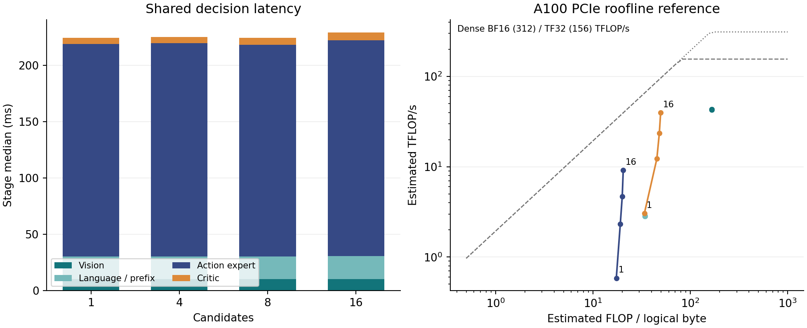

# Fixed-observation stage profile



On Object task 0, initial state 20, policy repeat 0, query 0, ten sequential action-expert steps accounted for 84% of stage time at N=1. Increasing N to 16 multiplied counted expert work by 16 while its median elapsed time rose 1.7%. Vision and language/prefix work stayed fixed at 488 GFLOP combined. That is 79% of counted work at N=1 and 19% at N=16. The critic rose from 5.70 to 6.97 ms. This result supports batching spare compute capacity and amortizing repeated weight access. Launch delays and memory hierarchy effects can both explain the observed scaling. Establishing their contributions would require kernel traces and hardware counters.

## Measurement

A shared A100 80 GB PCIe reported 0% utilization and 76,470 MiB free immediately before the run. For each candidate count the experiment used three warm-ups and twenty measured decisions, one GPU-resident preprocessed observation, fixed noise seed 20261120, BF16 VLM and FP32 expert/critic with TF32 matmul enabled. CUDA event intervals include host dispatch gaps. Each stage reports the median across decisions. The complete samples are in [profile.json](../results/profile.json).

Vision sums calls to the image encoder including the connector. Prefix includes image preparation, token assembly, prefix transformer, cached keys/values, feature pooling and loop setup. Expert begins with the first denoiser call and includes ten Euler updates and argument preparation for scoring. Critic covers the twin score and final selection. The chart sums stage medians. CPU pre/postprocessing, disk access and simulation are outside the measurement.

## FLOPs and traffic

A separate untimed forward used PyTorch FlopCounterMode for registered operations (two FLOPs per multiply-add). A dispatch hook classified CUDA tensor arguments and results by aliasing to a parameter storage and multiplied logical element count by dtype width. Pure view operators were omitted. Parameter writes were zero throughout. Shared storage, broadcasts, gather/embedding inputs, allocation-only results, internal kernel fusion and cache reuse make logical traffic differ from DRAM transactions. Attention and other operations are subject to the FLOP counter's operator coverage. The roofline uses the logical byte estimate on the x-axis and estimated FLOPs per median elapsed second on the y-axis. Its slope is the vendor's nominal 1,935 GB/s, with dense BF16 and TF32 ceilings. [NVIDIA A100 specifications](https://www.nvidia.com/en-us/data-center/a100/)

| N | Stage | ms | GFLOP | Weight read GB | Activation read GB | Activation write GB | FLOP/byte |
|---:|---|---:|---:|---:|---:|---:|---:|
| 1 | vision | 9.92 | 430.6 | 0.393 | 1.486 | 0.723 | 165.5 |
| 1 | prefix | 20.31 | 57.6 | 0.409 | 0.682 | 0.597 | 34.1 |
| 1 | expert | 188.68 | 110.2 | 2.062 | 2.302 | 1.973 | 17.4 |
| 1 | critic | 5.70 | 17.3 | 0.175 | 0.192 | 0.146 | 33.8 |
| 4 | vision | 9.92 | 430.6 | 0.393 | 1.486 | 0.723 | 165.5 |
| 4 | prefix | 20.26 | 57.6 | 0.409 | 0.682 | 0.597 | 34.1 |
| 4 | expert | 189.51 | 440.8 | 2.062 | 11.158 | 9.842 | 19.1 |
| 4 | critic | 5.65 | 69.3 | 0.175 | 0.766 | 0.586 | 45.4 |
| 8 | vision | 10.06 | 430.6 | 0.393 | 1.486 | 0.723 | 165.5 |
| 8 | prefix | 20.22 | 57.6 | 0.409 | 0.682 | 0.597 | 34.1 |
| 8 | expert | 188.21 | 881.5 | 2.062 | 22.316 | 19.684 | 20.0 |
| 8 | critic | 5.87 | 138.5 | 0.175 | 1.533 | 1.172 | 48.1 |
| 16 | vision | 10.07 | 430.6 | 0.393 | 1.486 | 0.723 | 165.5 |
| 16 | prefix | 20.33 | 57.6 | 0.409 | 0.682 | 0.597 | 34.1 |
| 16 | expert | 191.86 | 1763.0 | 2.062 | 44.632 | 39.367 | 20.5 |
| 16 | critic | 6.97 | 277.1 | 0.175 | 3.065 | 2.343 | 49.6 |

## Reproduction

Install the evaluation environment and expose the pinned VGAS modules on PYTHONPATH. Supply ACTOR_DIR, BACKBONE_DIR, CRITIC_CKPT, OBS_NPZ and EPISODE_JSON. The observation archive contains image, image2 and state, and the episode JSON supplies task_instruction. The exact recorded observation and task text are included in [examples/object_query](../examples/object_query/). GPU and runtime conditions influence timing.

```sh
export OBS_NPZ=examples/object_query/observation.npz EPISODE_JSON=examples/object_query/episode.json
python scripts/profile_decision.py --loader profile_loader:load --output profile.json
python scripts/profile_plot.py profile.json profile.png
```
