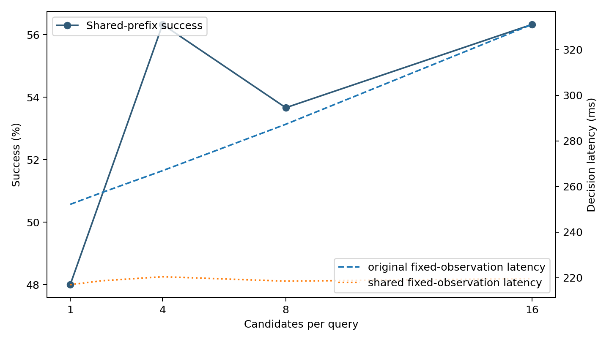

# From triggered correction to four-candidate selection

| Decision | What changed our mind | What we carried forward |
|---|---|---|
| Start with visual alerts and action correction | Early same-state branches contained recoveries and harms. A failed intervention could mean no useful candidate, a poor score, or harmful execution after the intervention. | Restore the same state and compare actual outcomes under the same continuation. |
| Test the two proposed components separately | Corrector with matched 10-step replanning reached 260/300 versus 258/300. Official QGF guidance helped in selected cube-triple settings; in visual Long Task2 the adjusted interval for QGF vs ZeroQ included zero. | Keep the original reproductions and their scope. Count extra replanning and evaluate the gradient against a matched zero-gradient arm. |
| Rank actions that the policy already proposes | Released VGAS supplies a compatible actor and task critic. In the corrected Object run, four-candidate shared selection rescued 65 paired trials and harmed 40 relative to one proposal. | Freeze both networks. Compare one proposal against four for outcome, then four against four for cost. |
| Share work within one decision | The candidate noise changes, while the observation is identical. The shared implementation used 216.78 ms versus 271.64 ms for original four-candidate inference on A100. | Encode once per observation, denoise independently, execute the actual highest-scoring candidate. |
| Check whether more work buys more success | Among 300 matched Object trials, shared Bo4, Bo8 and Bo16 reached 169, 161 and 169 successes. A further last-layer readout optimization preserved 20/20 replayed winners with no observed GPU speedup. | Keep four proposals and the original critic readout for the reported configuration. |

**Reading the figure.** The solid curve is closed-loop Object success (left axis). Dashed and dotted curves are original and shared decision latencies on a *fixed observation* (right axis). The README headline uses mean latency across rollout decisions. The two timing protocols answer different questions.

**One implementation detail changed the evidence.** An early executor scored the whole pool but always executed candidate zero. We excluded that run, repaired dispatch, and reran all five Object arms (1,500 episodes). The [selection code](../method/shared_prefix_selection.py) preserves the winner index through the batch slice. The [recorded decision example](../examples/inspect_decision.py) exposes actual scores and their stored winner.

[Reproduction results and controls](../workshop/README.md) · [Experiment archive](EXPERIMENT_ARCHIVE.md) · [Readout experiment](HARDWARE_ANALYSIS.md)
