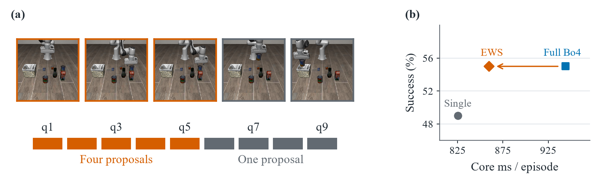

# 在 VGAS 上把选优算力放到回合前段

用原版 SmolVLA 生成动作候选、原版 VGAS critic 排序。我们改变的是**哪些查询花算力选四个动作**，并实现了同一观测的一次编码、四候选共享前缀，以及 A100 CUDA Graph 测量。

**(a)** 展示第 1、3、5、7、9 次查询的观测帧，色条覆盖这次回合的全部查询。**(b)** 对比同一批 200 个布局在 CUDA Graph 下的成功率和平均核心推理时间。

1. **收益集中在早段。** 500 个配对 Object 布局中，前五次选优比延后启用高 **7.60 个百分点**（95% 配对区间 [2.60, 12.60]）。在标定队列，前五次用 **48.4%** 的四选一调用，捕获全程增益的 **92%**。
2. **节省调用也节省实际推理时间。** 新 Object 布局在同一套 CUDA Graph 测量中，EWS 与全程 Bo4 均成功 **110/200**。EWS 每回合核心推理从 **943.96 ms** 降至 **859.41 ms**（**−9.0%**）。相对同路径单候选，平均多 **34.22 ms**。Goal 和 Spatial 通过预注册的点估计标准，Long 只测了 Task2。
3. **候选成败分化和评分质量限制收益。** Object 前三次查询中，固定池同状态排序 AUC 为 **0.55**。Plus 固定光照下，同一光照候选池只换评分图，就有 **26/150** 次赢家改变。筛出的 39 个可重放锚点上，干净图评分选中 **14** 次成功，扰动图选中 **10** 次，区间上界到零。

**待解决的问题。** 光照同时影响动作生成与评分。现有分支只检验了评分端在所选早期状态上的后果，生成端的闭环影响和总体失效归因仍待验证。硬件结论覆盖 A100 核心推理时间。

[论文与完整主表](../paper/main.pdf) · [证据核对](../paper/CLAIMS_AUDIT.md) · [复现说明](../docs/REPRODUCIBILITY.md)
