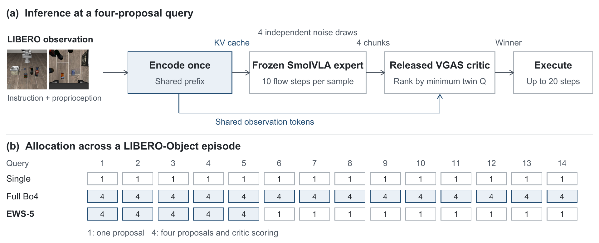

# Hardware manuscript draft

Read the [LaTeX draft](main.tex) and [claims audit](CLAIMS_AUDIT.md).
The draft uses a venue-neutral two-column format and retains placeholders for author information.

From the repository root, regenerate the tables and figures with NumPy, Matplotlib, ReportLab and Pillow, then compile using Tectonic:

    python scripts/make_paper_tables.py
    python scripts/summarize_scheduled_selection.py
    python scripts/summarize_marginal_value.py
    python scripts/summarize_critic_oracle.py
    python scripts/plot_q0_gate.py
    python scripts/summarize_episode_cost.py
    python scripts/summarize_graph_closed_loop.py
    python paper/plot_graph_closed_loop.py
    pdftoppm -r 240 -singlefile -png paper/figures/graph-closed-loop.pdf paper/figures/graph-closed-loop
    python paper/make_overview.py
    pdftoppm -r 240 -singlefile -png paper/figures/method-overview.pdf paper/figures/method-overview
    python paper/make_figures.py
    tectonic --outdir paper paper/main.tex

The overview diagrams the implemented data flow, execution horizon and Object schedule. The dose plot uses the released scheduled-selection ledgers. The two timing plots draw on matched fixed-observation timing and stage profiling. The fixed-observation eager VGAS scaling sweep uses a separate protocol from the matched Graph experiment.

Before submission, finalize authors, affiliations, funding, venue and anonymity policy. Confirm the arXiv account, posting date and release timing. Hardware measurements in this draft are scoped to A100.
